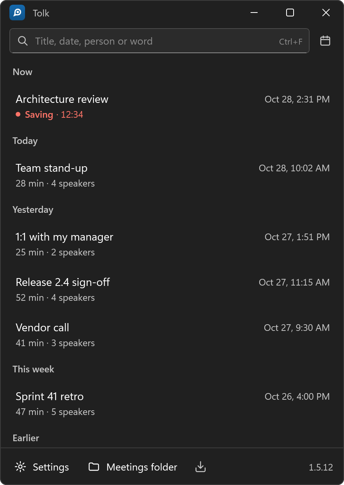
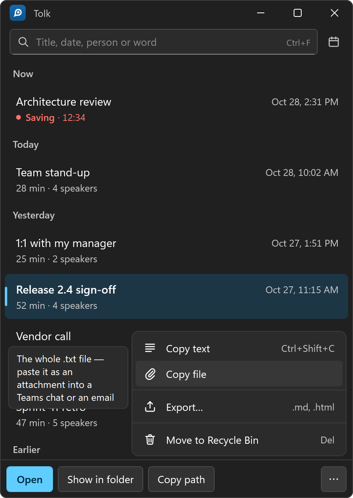
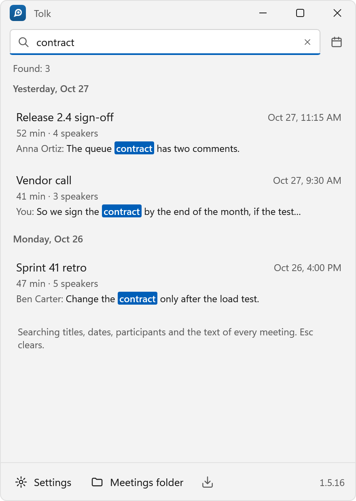
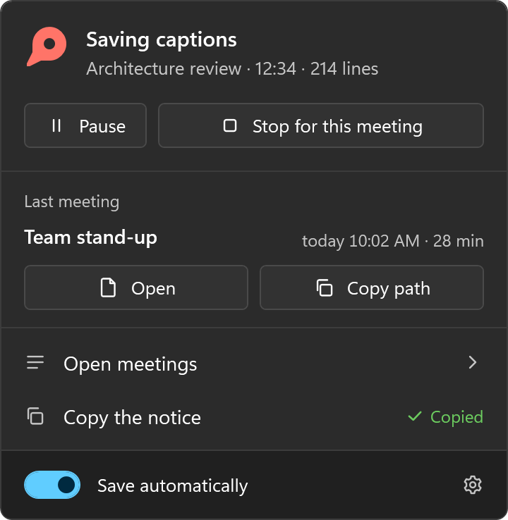
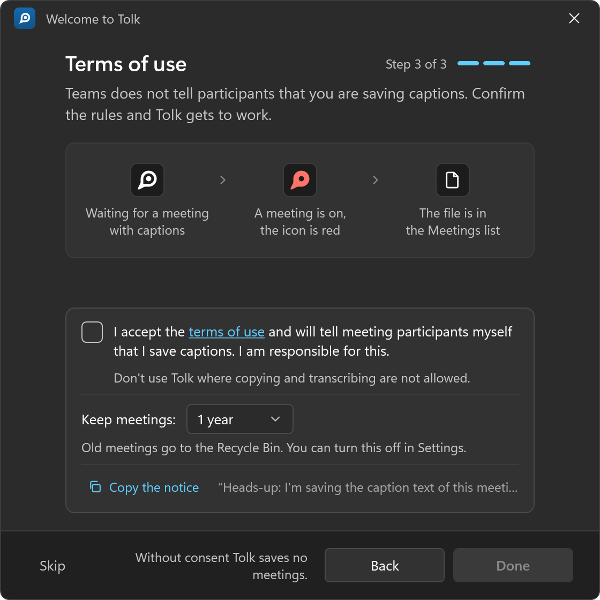
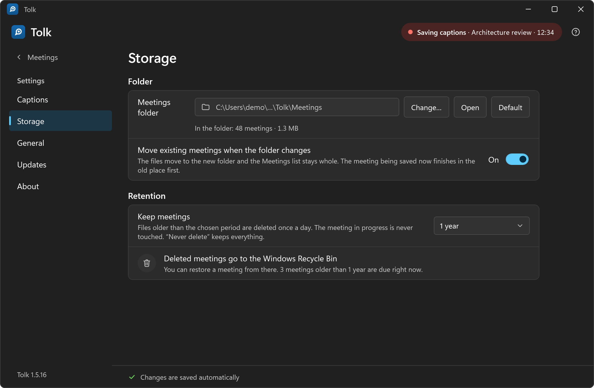
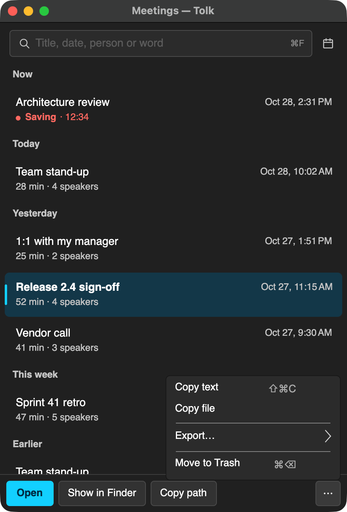
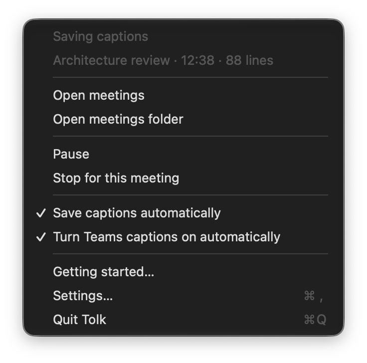

  

<h1 align="center">Tolk</h1>

Your Teams meetings as plain text files — saved from the live captions, locally.

  
  
  
  

  <a href="https://github.com/Ilyakz/tolk/releases/latest"><b>Download for Windows or macOS</b></a>
  &nbsp;·&nbsp; <a href="README.ru.md">Русская версия</a>

**Tolk** saves the live captions of your Microsoft Teams meetings as plain text files on your
computer: when, who and what was said. Teams does the speech recognition; Tolk records no audio or
video, has no servers and sends nothing anywhere.

> **Your responsibility:** Teams does not tell participants that you save the captions. Tell them
> yourself (**Copy the notice** gives you a ready chat message) and don't use Tolk where copying or
> transcription is not allowed. Tolk saves nothing until you accept these terms on its first start.

## Screenshots

<table>
  <tr>
    <td width="50%"></td>
    <td width="50%"></td>
  </tr>
  <tr>
    <td align="center">All your meetings, the one being saved at the top</td>
    <td align="center">Open, show in folder, copy the path, text or file</td>
  </tr>
  <tr>
    <td width="50%"></td>
    <td width="50%"></td>
  </tr>
  <tr>
    <td align="center">Search titles, dates, people and what was said</td>
    <td align="center">The tray panel: what is being saved right now</td>
  </tr>
  <tr>
    <td width="50%"></td>
    <td width="50%"></td>
  </tr>
  <tr>
    <td align="center">First start: accept the terms, choose how long to keep meetings</td>
    <td align="center">Settings: where meetings are kept and for how long</td>
  </tr>
</table>

**On macOS** — the same list, and the menu-bar menu:

<table>
  <tr>
    <td width="50%"></td>
    <td width="50%"></td>
  </tr>
</table>

The screenshots show a demo build with made-up meetings and names.

## Features

- **Automatic.** A meeting shows captions — Tolk saves it. Rejoin within 10 minutes and the same file continues.
- **Tray icon** shows the state: waiting, saving, paused, needs attention. Pause or skip a meeting in one click.
- **Notifications** when saving starts and stops, and when a meeting runs with captions off.
- **Meetings list** by day with search across titles, people and text. Open, show in folder, copy path, text or file, export to Markdown, HTML, JSON or CSV.
- **Kept for 1 year** by default, then to the Recycle Bin. Change it or turn it off.
- **Hidden from screen sharing.** Import of Teams recording transcripts (`.vtt`). English and Russian, light and dark.

## Get started

### Windows

1. Download `Tolk-<version>-setup.exe` from **[Releases](https://github.com/Ilyakz/tolk/releases/latest)** and run it.
   The installer is not code-signed yet: on "Windows protected your PC" click **More info → Run anyway**.
2. In Teams: **Settings → Accessibility → Always show captions in my calls and meetings** — then every meeting is saved without you doing anything.
3. Accept the terms in Tolk's welcome window. Done: meetings appear in the list.

Needs Windows 10 (2004+) or 11, x64, and the new Teams desktop app (not Teams in a browser).

### macOS (preview)

1. Download `Tolk-<version>-mac-arm64.dmg` from **[Releases](https://github.com/Ilyakz/tolk/releases/latest)**, open it and drag Tolk to Applications.
2. The app is not notarized by Apple yet: the first time, macOS refuses to open it. Go to **System Settings → Privacy & Security** and click **Open Anyway**.
3. Allow Tolk in **System Settings → Privacy & Security → Accessibility** (Tolk opens the page). Once: updates keep it.
4. Accept the terms in Tolk's welcome window. Tolk turns Teams' captions on by itself when a call starts (can be turned off in its menu).

Needs macOS 13 or later on Apple Silicon, and the new Teams. Not on the Mac yet: notifications and hiding Tolk's
windows from screen sharing. A meeting window in full screen on another desktop cannot be read — Tolk shows it
and suggests popping the captions out.

## Privacy

Everything stays on your computer: no telemetry, no accounts. The network is used only to check
GitHub for updates (can be turned off). Notifications show the meeting's title, never what was said.
Details: [docs/PRIVACY.md](docs/PRIVACY.md).

## Limitations

- Tolk reads the Teams window through the system accessibility interface (UI Automation on Windows, Accessibility on macOS). A Teams update can break it until Tolk is updated.
- A transcript is as good as Teams' captions: words can be misheard and speakers mixed up.

**More:** install options, updates, uninstall, where files are, FAQ — **[docs/GUIDE.md](docs/GUIDE.md)**.

---

Microsoft, Teams and Windows are trademarks of the Microsoft group of companies; Apple, Mac and macOS
are trademarks of Apple Inc. Tolk is an independent project, not affiliated with or endorsed by Microsoft or Apple.
Licensed under [Apache 2.0](LICENSE) · [NOTICE](NOTICE) · [Third-party notices](THIRD-PARTY-NOTICES.txt)
