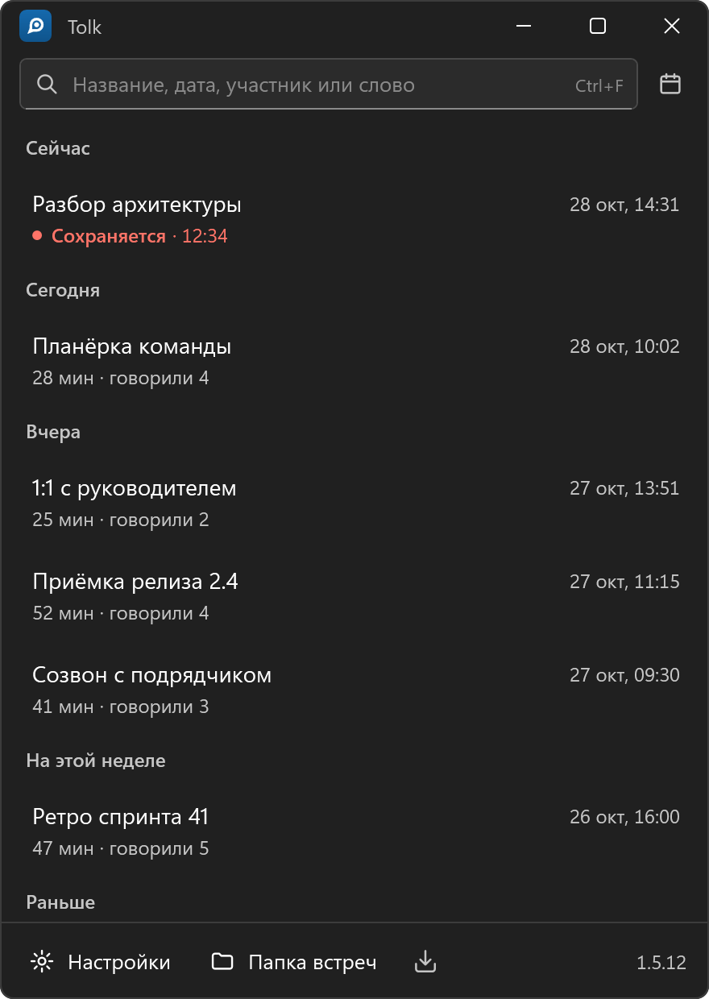
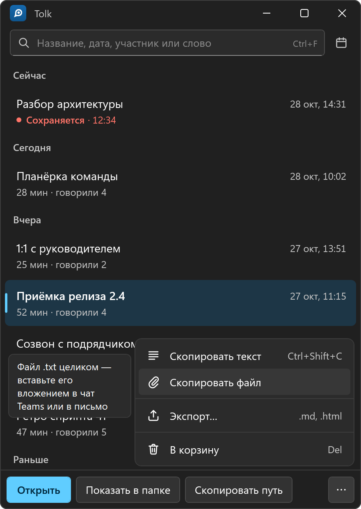
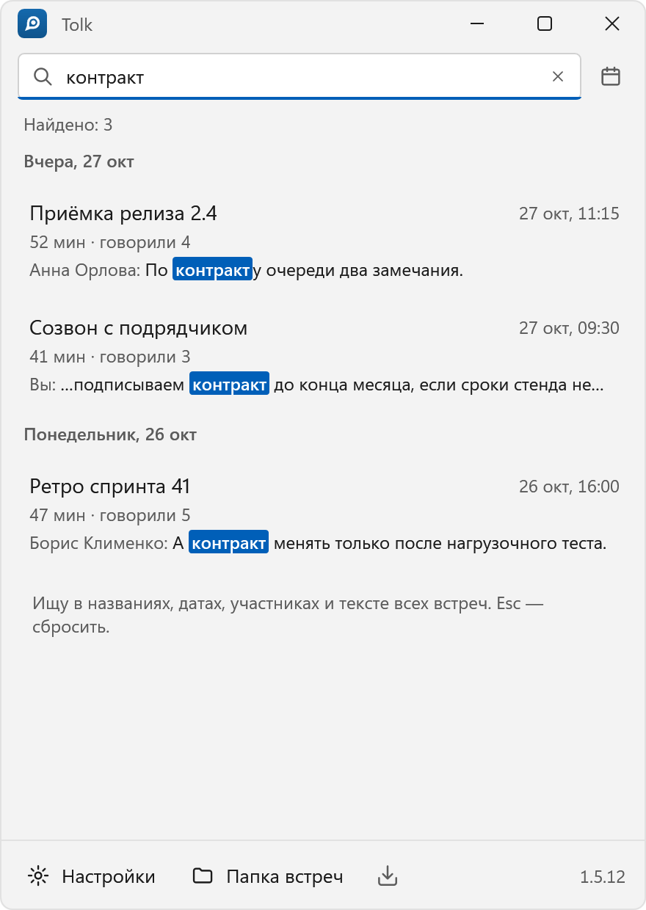
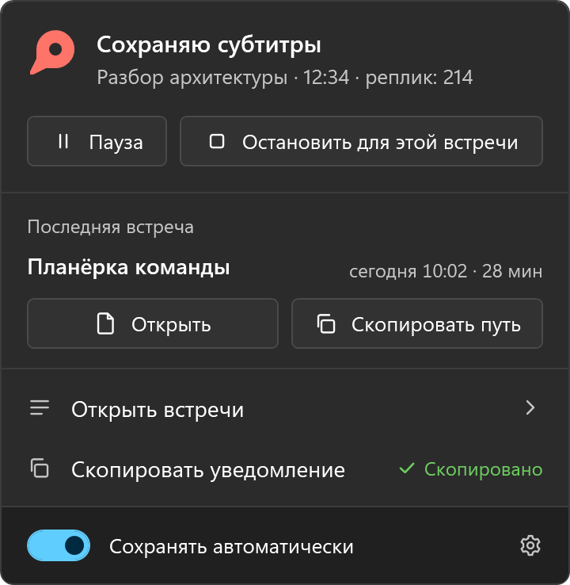
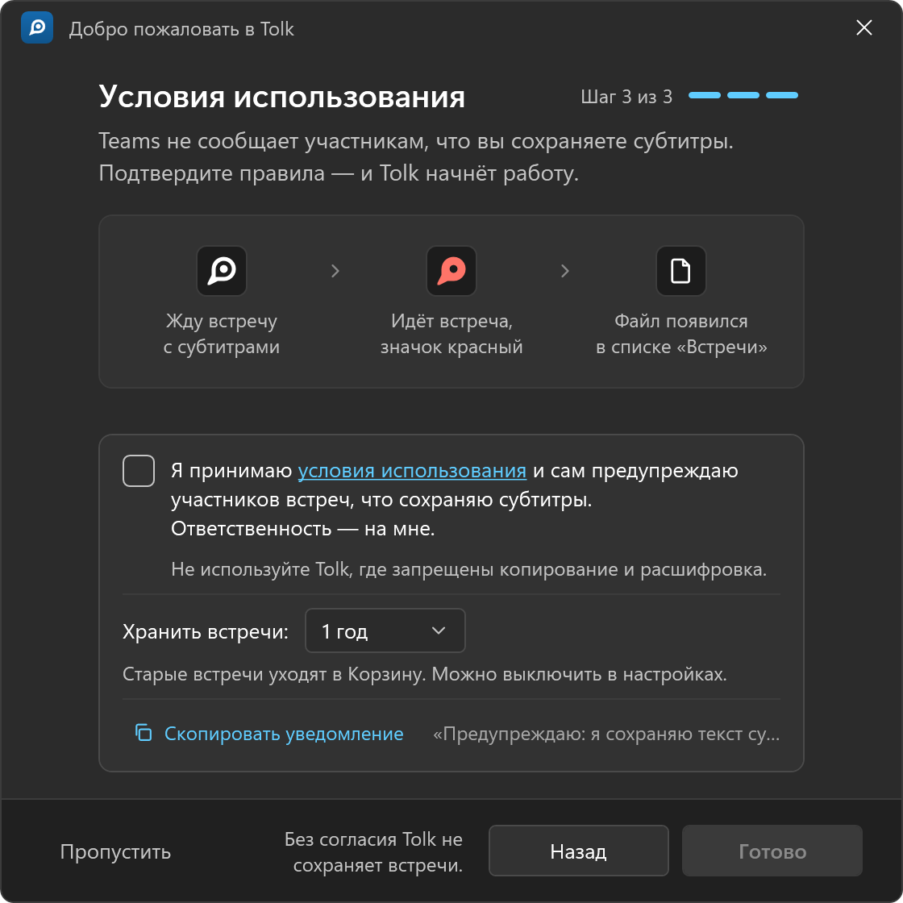
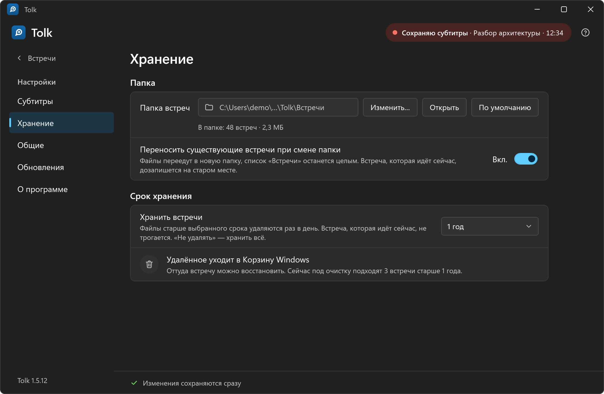
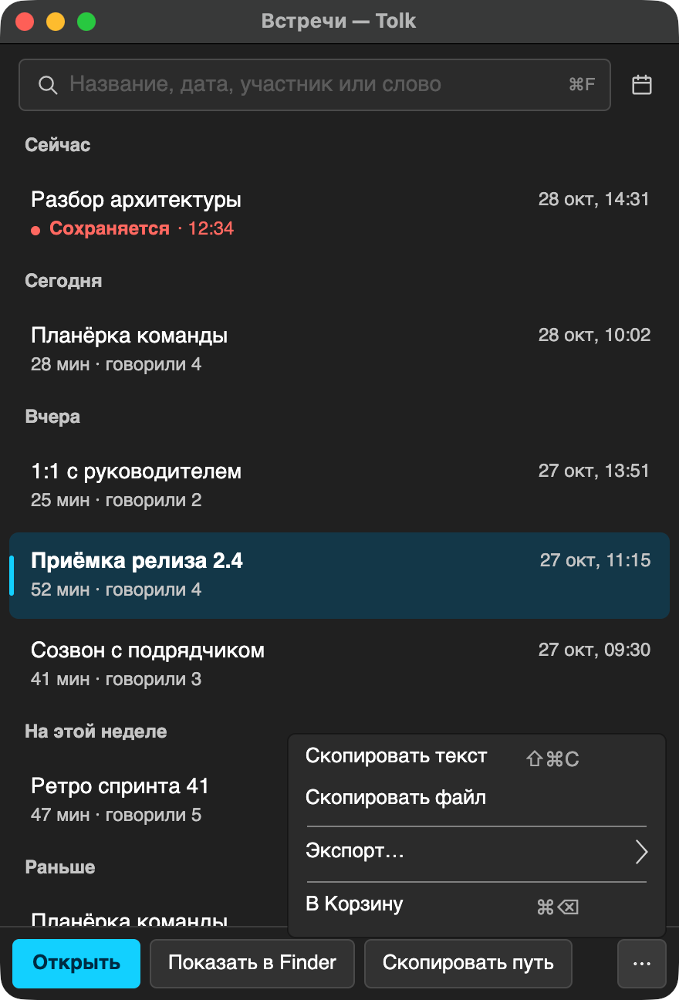
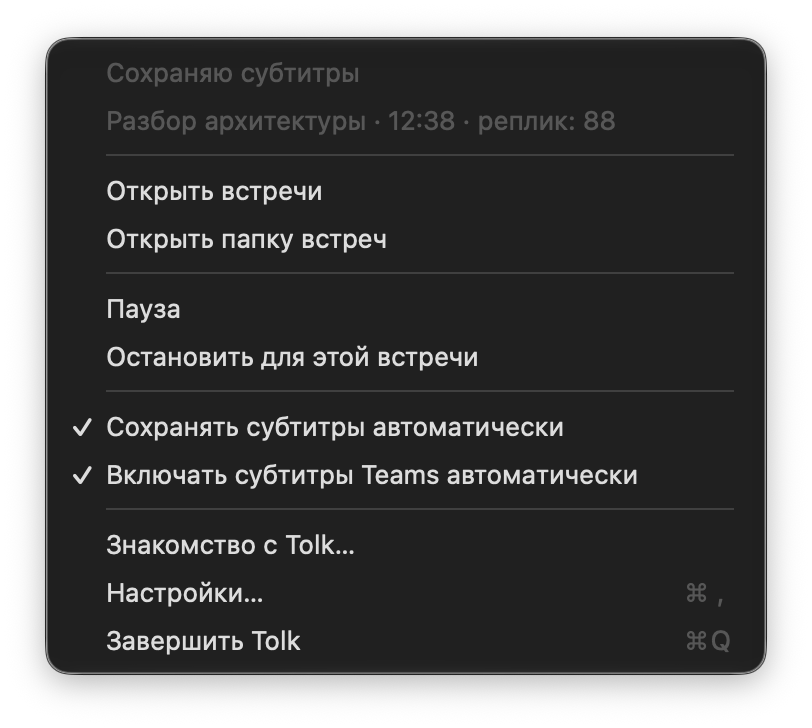

  

<h1 align="center">Tolk</h1>

Встречи Teams — в обычные текстовые файлы, из живых субтитров, локально.

  
  
  
  

  <a href="https://github.com/Ilyakz/tolk/releases/latest"><b>Скачать для Windows или macOS</b></a>
  &nbsp;·&nbsp; <a href="README.md">English</a>

**Tolk** сохраняет живые субтитры ваших встреч в Microsoft Teams в обычные текстовые файлы на вашем
компьютере: когда, кто и что сказал. Речь распознаёт сам Teams; Tolk не записывает звук и видео, у
него нет серверов, и он ничего никуда не отправляет.

> **Ответственность — ваша:** Teams не сообщает участникам, что вы сохраняете субтитры. Предупредите
> их сами (**«Скопировать уведомление»** даёт готовое сообщение для чата) и не используйте Tolk там,
> где копирование или расшифровка запрещены. Пока вы не примете эти условия при первом запуске, Tolk
> ничего не сохраняет.

## Как это выглядит

<table>
  <tr>
    <td width="50%"></td>
    <td width="50%"></td>
  </tr>
  <tr>
    <td align="center">Все встречи, сверху — та, что сохраняется сейчас</td>
    <td align="center">Открыть, показать в папке, скопировать путь, текст или файл</td>
  </tr>
  <tr>
    <td width="50%"></td>
    <td width="50%"></td>
  </tr>
  <tr>
    <td align="center">Поиск по названиям, датам, людям и сказанному</td>
    <td align="center">Панель у значка в трее: что сохраняется сейчас</td>
  </tr>
  <tr>
    <td width="50%"></td>
    <td width="50%"></td>
  </tr>
  <tr>
    <td align="center">Первый запуск: принять условия и выбрать, сколько хранить встречи</td>
    <td align="center">Настройки: где и сколько хранятся встречи</td>
  </tr>
</table>

**На macOS** — тот же список и меню в строке меню:

<table>
  <tr>
    <td width="50%"></td>
    <td width="50%"></td>
  </tr>
</table>

На снимках — демонстрационная сборка с вымышленными встречами и именами.

## Возможности

- **Сам.** На встрече появились субтитры — Tolk её сохраняет. Вернулись в течение 10 минут — запись продолжается в том же файле.
- **Значок в трее** показывает состояние: ждёт, сохраняет, пауза, нужно внимание. Пауза или пропуск встречи — в один клик.
- **Уведомления** о начале и конце записи и о встрече с выключенными субтитрами.
- **Список встреч** по дням с поиском по названиям, людям и тексту. Открыть, показать в папке, скопировать путь, текст или файл, экспорт в Markdown, HTML, JSON или CSV.
- **Хранит 1 год** по умолчанию, потом — в корзину. Срок можно изменить или отключить.
- **Скрыт при показе экрана.** Импорт стенограмм записей Teams (`.vtt`). Русский и английский, светлая и тёмная тема.

## Как начать

### Windows

1. Скачайте `Tolk-<версия>-setup.exe` в **[Releases](https://github.com/Ilyakz/tolk/releases/latest)** и запустите.
   Установщик пока без цифровой подписи: на «Система Windows защитила ваш компьютер» нажмите **Подробнее → Выполнить в любом случае**.
2. В Teams: **Настройки → Специальные возможности → «Всегда показывать субтитры в звонках и собраниях»** — и каждая встреча сохранится без вашего участия.
3. Примите условия в окне приветствия Tolk. Готово: встречи появятся в списке.

Нужны Windows 10 (2004+) или 11, x64, и новое классическое приложение Teams (не Teams в браузере).

### macOS (предварительная версия)

1. Скачайте `Tolk-<версия>-mac-arm64.dmg` в **[Releases](https://github.com/Ilyakz/tolk/releases/latest)**, откройте и перетащите Tolk в «Программы».
2. Приложение пока не заверено Apple: в первый раз macOS откажется его открыть. Откройте **Системные настройки → Конфиденциальность и безопасность** и нажмите кнопку **«Всё равно открыть»** внизу.
3. Разрешите Tolk в **Системные настройки → Конфиденциальность и безопасность → Универсальный доступ** (Tolk сам откроет нужное место). Один раз: обновления его сохраняют.
4. Примите условия в окне приветствия Tolk. Субтитры Teams Tolk включает сам, когда начинается звонок (можно отключить в его меню).

Нужны macOS 13 или новее на Apple Silicon и новое приложение Teams. На Mac пока нет уведомлений и скрытия окон
Tolk при показе экрана. Окно встречи во весь экран на другом рабочем столе прочитать нельзя — Tolk об этом
сообщает и предлагает вынести субтитры в отдельное окно.

## Конфиденциальность

Всё остаётся на вашем компьютере: без телеметрии и учётных записей. В сеть Tolk выходит только
проверить обновления на GitHub (можно отключить). В уведомлениях — название встречи, но никогда не
то, что было сказано. Подробно: [docs/PRIVACY.ru.md](docs/PRIVACY.ru.md).

## Ограничения

- Tolk читает окно Teams через системный интерфейс специальных возможностей (UI Automation в Windows, Accessibility в macOS). Обновление Teams может его сломать, пока не выйдет новая версия Tolk.
- Расшифровка не лучше субтитров Teams: слова могут быть распознаны неверно, говорящие — перепутаны.

**Подробнее:** варианты установки, обновление, удаление, где лежат файлы, вопросы и ответы — **[docs/GUIDE.ru.md](docs/GUIDE.ru.md)**.

---

Microsoft, Teams и Windows — товарные знаки группы компаний Microsoft; Apple, Mac и macOS — товарные
знаки Apple Inc. Tolk — независимый проект, не связанный с Microsoft или Apple и не одобренный ими.
Лицензия [Apache 2.0](LICENSE) · [NOTICE](NOTICE) · [Сторонние компоненты](THIRD-PARTY-NOTICES.txt)
